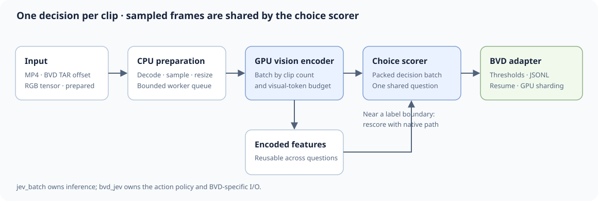

# VideoJev batch inference for BVD

`jev_batch` runs batched VideoJev choice inference on MP4 files, sampled RGB frames, prepared patches, or previously encoded vision features. `bvd_jev` adds the BVD action question, labels, TAR input, a CLI, and a small review UI.



## Run

`pyproject.toml` records the Python 3.12/aarch64 CUDA dependencies and provides `bvd-jev` and `bvd-jev-ui` entry points. Download the VideoJev checkpoint separately. On the tested GH200, the existing environment and checkpoint are under `/e/scratch/reformo/blanchon1/bvd_action_runtime/`. To use an existing compatible environment without changing it:

```bash
export UV_PROJECT_ENVIRONMENT=/path/to/compatible/venv
export VIDEOJEV_MODEL=/path/to/VideoJev-4B
export HF_HUB_OFFLINE=1 TRANSFORMERS_OFFLINE=1
uv run --no-sync --offline python -m bvd_jev.cli path/to/video.mp4 \
  --output /tmp/bvd-actions.jsonl --fuse-vision-rope
```

The input can be an MP4, directory of MP4/TAR files, TAR shard, or JSON/JSONL manifest. A manifest row can provide `path`, or `source_tar`, `source_byte_offset`, and `bytes` for an already downloaded BVD clip. Use `--resume` to continue a run and `--num-shards`/`--shard-index` to distribute work across GPUs. Run `uv run --no-sync --offline python -m bvd_jev.cli --help` for all settings.

For the local review UI:

```bash
uv run --no-sync --offline python -m uvicorn bvd_jev.serve:app --host 127.0.0.1 --port 8000
```

Open `/ui`. The optional local example videos appear there when present. This public code repository does not distribute BVD media. Apache-2.0 covers this code; model weights and datasets retain their own terms.

## Library

```python
from jev_batch import BatchRunner, ChoiceQuestion, Item, Sampling, VideoJevEngine

engine = VideoJevEngine("/path/to/VideoJev-4B")
question = ChoiceQuestion("What is visible?", ("A person handles an object", "No person handles an object"))
items = [Item("clip-1", "clip.mp4")]
for item, result in BatchRunner(engine, question, sampling=Sampling(fps=1, max_frames=16)).run(items):
    print(item.id, result["probabilities"])
```

The library also accepts `VideoFrames` for already sampled NumPy or Torch RGB frames. `engine.prepare(...)` and `engine.encode(...)` let callers reuse vision features for more than one question. See [architecture](docs/architecture.md) for the data path and [BVD policy](docs/bvd.md) for the action definition.

## Measured speed

On a local GH200, the VideoJev-4B pipeline processed **11.59 clips/s and 171 sampled frames/s** on a 1,000-clip holdout. Warm 300-clip runs of the consolidated code processed **12.06–12.68 clips/s**, about **179–188 sampled frames/s**. These are end-to-end TAR-to-result rates, excluding model load, at 1 sampled FPS and at most 16 frames per clip. See [measurements](docs/measurements.md) for evidence and limits.
