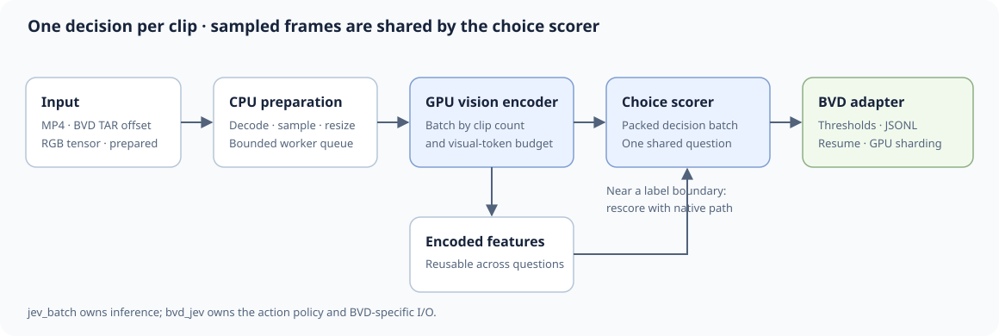

# Inference paths and cost



VideoJev receives sampled frames, a question, and candidate answers. Its vision
encoder builds video features. A causal backbone then processes the video and
question tokens, and a decision head scores the candidates. There is no
one-token-at-a-time answer generation. See the
[VideoJev project](https://mcg-nju.github.io/VideoJev/) for the model design.

A useful cost sketch is:

```text
video read + frame preparation + vision encoding + backbone prefill + choice scores
```

For multiple questions, video encoding can be shared. In native joint mode,
questions that fit the context also share the video prefix in one backbone
forward pass. More questions still add tokens and scoring work; if they exceed
the context, VideoJev splits them into more forwards.

## Which API to use?

| Workload | API | What is shared? |
| --- | --- | --- |
| One question across many videos | `BatchRunner` or `bvd_jev.cli` | CPU preparation and GPU batching across clips |
| Several questions about one video | `VideoJevEngine.predict_questions` | Video encoding and joint video prefix where context allows |
| Questions arriving later | `engine.prepare` → `engine.encode` → `predict_prepared_batch` | Vision features; decision prefill runs again |

The **measured fast path** is the first row. It handles one `ChoiceQuestion` per
video batch, with packed variable-length attention for VideoJev-4B. The native
joint path is useful for several labels on one clip, but its dataset-scale
throughput has not been measured in this repository. Neither path makes extra
classifications free.

## What happens in a batch?

1. CPU workers read MP4 files or BVD TAR offsets and sample frames. The default
   is 1 sampled FPS, capped at 16 frames across the clip.
2. A bounded queue keeps prepared clips ready. Batches obey both a clip-count
   limit and a visual-token budget.
3. The GPU encodes the frames and scores the supplied choices. Results return
   in input order.
4. The BVD adapter maps scores to action labels and writes resumable JSONL.
   Scores near its label boundaries are checked with native VideoJev scoring.

Inputs may also be already sampled NumPy/Torch RGB frames (`VideoFrames`),
prepared patches, or encoded features. `jev_batch` owns these generic inputs;
`bvd_jev` owns BVD paths, the action policy, and the review UI.

The maintained engine uses BF16. It does not currently expose video-token
pruning, FP8, or CUDA graphs. Those are possible experiments, not measured
features of this implementation.
