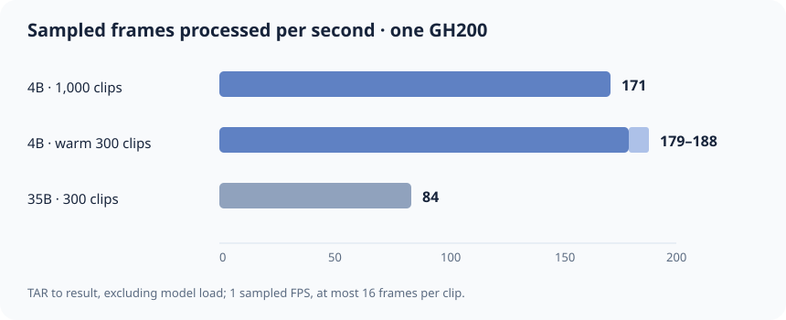

# Local throughput measurements

All numbers below are from **one NVIDIA GH200** with VideoJev, BVD TAR clips, **1 sampled FPS**, at most **16 frames per clip**, and **4096 context tokens**. They measure TAR read, CPU decode/preparation, GPU vision and decision scoring, and result writing. **Model loading is excluded.** Sampled frames per second counts frames passed to the vision model, not all source frames decoded from the MP4.

| Run | Clips | Clip/s | Sampled frames/s | Notes |
| --- | ---: | ---: | ---: | --- |
| 4B optimized holdout | 1,000 | 11.59 | 171 | 14,767 sampled frames in 86.28 s; historical compiled Flash path |
| 4B consolidated, warm | 300 | 12.06–12.68 | 179–188 | Same mixed set, 4,444 sampled frames; identical probabilities and labels to the preceding legacy run |
| 35B-A3B padded guard | 300 | 5.68 | 84 | 4,444 sampled frames in 52.85 s; different executor path |

The 1,000-clip result is the larger sustained check. These speed records predate the latest typing and packaging cleanup; the GPU API smoke passed afterward, but throughput has not been remeasured under an uncontended GPU. The warm 300-clip runs verify that the cleaned library retained the preceding implementation's speed on that set; cold cache was slower. The 35B result is **not** a controlled 4B-versus-35B quality/cost comparison. These runs used a shared local GPU and local storage, so they do not establish throughput on a 4-GPU GB200 node or on uncached RAW videos.

For local audit, the original run records and scripts are preserved outside this public repository in `../bvd_action_archives/research-before-cleanup-2026-11-12.tar.gz` under `experiments/legacy_videojev_poc/`. Key records: `videojev4b-compiled-flash-holdout1000.jsonl.summary.json`, `videojev35b-paddedguard2-300.jsonl.summary.json`, and the adjacent 300-clip consolidation results described in the original README. The archive was verified against the original files before cleanup.

For a new benchmark, hold the clip manifest, model, question, sample FPS, maximum frames, codec settings, and storage cache state fixed. Report valid clips/s, sampled frames/s, GPU memory, failures, and action-label agreement. The repository's `experiments.check_api` is an API correctness check, not a throughput benchmark.
